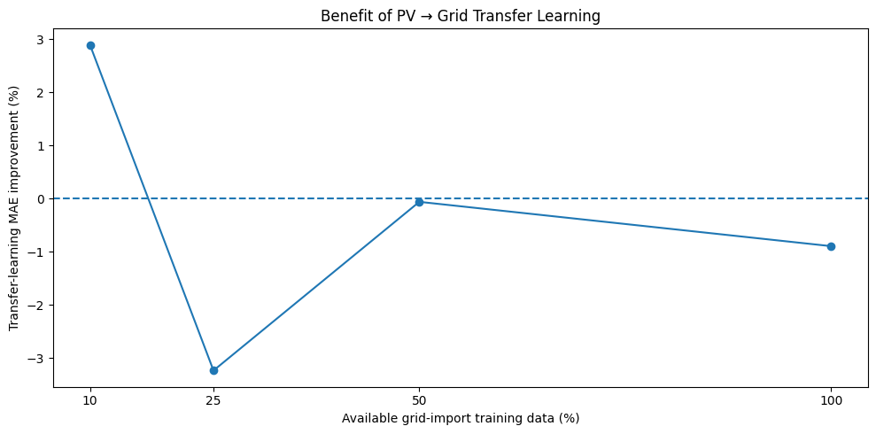
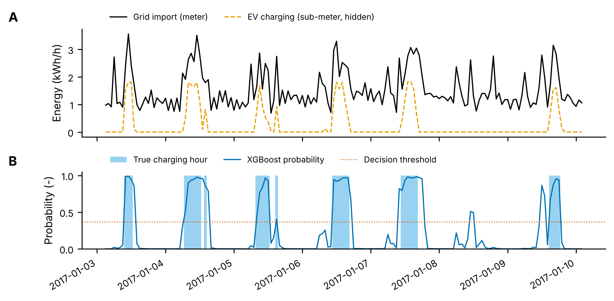
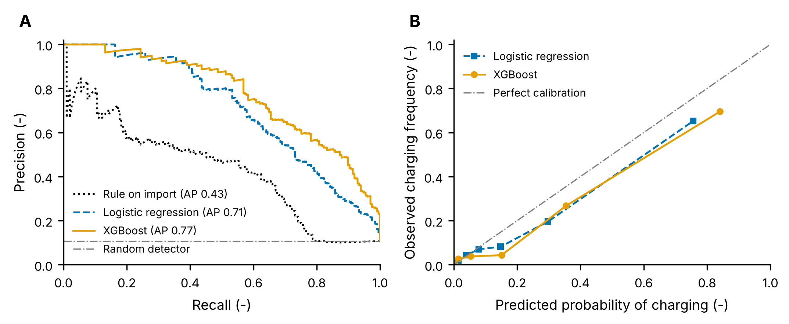
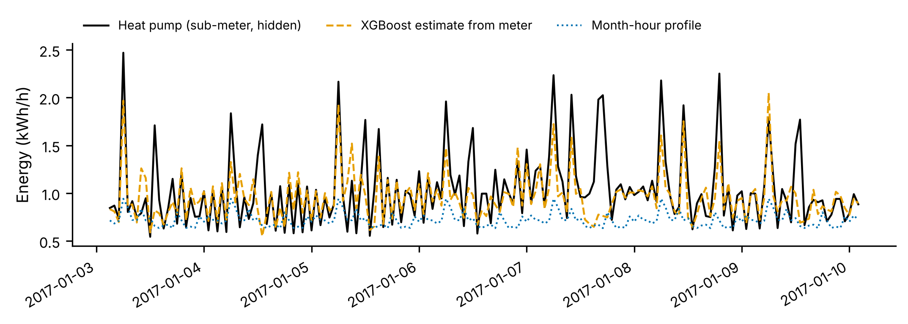
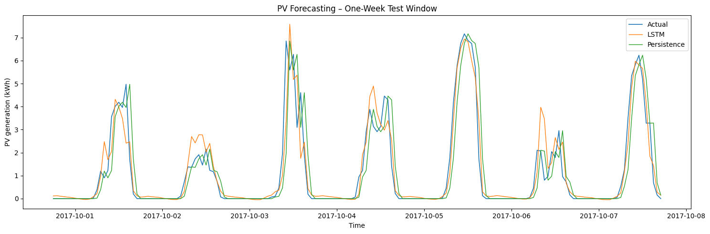
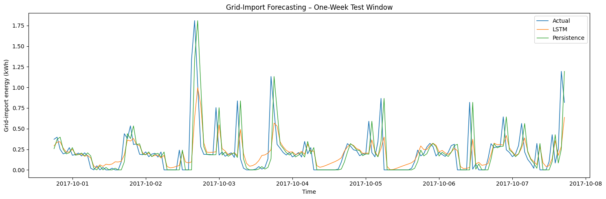

# Household Energy Forecasting, Transfer Learning and Asset Identification

Machine learning on measured data from a single German household with PV, an electric vehicle and a heat pump:

- **Forecasting:** next-hour PV generation and grid import with a persistence baseline, an LSTM and a Transformer encoder, plus a transfer-learning test from PV to grid import when grid data are scarce.
- **Asset identification:** detecting EV charging (classification) and estimating heat-pump consumption (disaggregation) from what a smart meter sees, grid import and export only.

| | |
|---|---|
| **Data** | Open Power System Data household dataset, Residential 4 (southern Germany), hourly, Oct 2015 to Feb 2018 |
| **Tasks** | Next-hour forecasting from a 24-hour window; EV charging detection and heat-pump disaggregation from meter data |
| **Models** | Persistence, LSTM (TensorFlow/Keras), Transformer encoder (PyTorch); rule baseline, logistic regression, XGBoost |
| **Evaluation** | Chronological 70/15/15 train/validation/test split; MAE and RMSE for forecasting; precision, recall, F1, PR-AUC, calibration for detection |

## Key results: forecasting

| Target | Model | MAE (kWh) | RMSE (kWh) | MAE vs persistence |
|---|---|---:|---:|---:|
| PV | Persistence | 0.371 | 0.722 | |
| PV | **LSTM** | **0.257** | **0.501** | **−31%** |
| PV | Transformer | 0.282 | | −24% |
| Grid import | Persistence | 0.330 | 0.485 | |
| Grid import | LSTM | 0.281 | **0.398** | −15% |
| Grid import | **Transformer** | **0.269** | | **−18%** |

- The LSTM is the best PV model. For grid import the Transformer has the lowest MAE, while the LSTM keeps a slightly lower RMSE, so neither architecture wins everywhere.
- Transfer learning from PV to grid import gives a small gain only when target data are scarce: about **2.9% lower MAE with 10%** of the grid training data. With 25%, 50% and 100% of the data the effect is −3.2%, about 0% and −0.9%, so the benefit is not consistent.



*Change in grid-import MAE when the Transformer is initialised from the PV model instead of trained from scratch (positive = transfer helps).*

## Key results: asset identification from smart-meter data

The household has sub-meters on its EV charger and heat pump. They provide the true labels, while the models only see hourly grid import and export, as a supplier would (`05_asset_identification.ipynb`).

**EV charging detection.** An hour counts as charging when the EV uses more than 0.2 kWh, which happens in about 9% of hours. Decision thresholds are chosen on the validation set; the test set covers December 2016 to March 2017.

| Detector | Precision | Recall | F1 | PR-AUC | ROC-AUC |
|---|---:|---:|---:|---:|---:|
| Rule on grid import | 0.37 | 0.66 | 0.47 | 0.43 | 0.74 |
| Logistic regression | 0.59 | 0.66 | 0.62 | 0.71 | 0.92 |
| **XGBoost** (mean of 5 seeds) | 0.57 | **0.79** | **0.66** | **0.78** | **0.95** |

- XGBoost finds about four in five charging hours. Its F1 varies by only ±0.02 across five seeds.
- Its probabilities are slightly overconfident at the top end (Brier score 0.051). For example, hours given about 0.8 turn out to be charging about 70% of the time.
- Hour of day is the most important feature, together with the import level and its change. The detector therefore combines the physical signature of charging with this household's charging habits.



*One test week: grid import with the hidden EV sub-meter (A), and the true charging hours with the XGBoost probability (B).*



**Heat-pump disaggregation.** In winter the heat pump runs almost continuously and modulates its power, so its hourly consumption is estimated instead of an on/off state. On the winter test set, XGBoost on meter features has an MAE of 0.16 kWh/h, **43% lower** than a month and hour-of-day profile (0.28 kWh/h). It underestimates the test-period total by 10%, against 24% for the profile.



## Method

**Preprocessing** (`01_data_exploration.ipynb`)
- The raw data are cumulative meter readings. Hourly energy is obtained by differencing consecutive readings that are exactly one hour apart.
- The longest continuous valid block is kept: 2015-10-10 16:00 to 2018-02-04 23:00 UTC, giving 20,359 hourly values. No negative increments occur in the PV or grid-import series.
- Chronological 70/15/15 split; scalers are fitted on the training set only, so no information leaks from validation or test data.

**LSTM** (`02_lstm_forecasting.ipynb`): LSTM(64) → Dropout(0.2) → Dense(32, ReLU) → Dense(1); Adam, MSE loss, batch 64, up to 30 epochs with early stopping (patience 5, best weights restored).

**Transformer** (`03_transformer_forecasting.ipynb`): linear projection to d_model = 64, sinusoidal positional encoding, 2 encoder layers with 4 heads, feed-forward size 128, dropout 0.1, GELU, then Dense(32) and a linear output.

**Transfer learning** (`04_transfer_learning.ipynb`): the input projection and encoder of a Transformer trained on PV are reused for grid import, with a new forecasting head. This is compared with a Transformer trained from scratch, using 10%, 25%, 50% and 100% of the grid-import training data.

## Figures

| PV, one test week | Grid import, one test week |
|---|---|
|  |  |

Training and validation loss curves: [PV](figures/pv_training_loss.png), [grid import](figures/grid_training_loss.png).

## How to run

```bash
pip install -r requirements.txt
jupyter lab            # then run the notebooks in order, from the notebooks/ folder
```

Notebook 01 creates `data/residential4_model_data.csv`, which notebooks 02 to 04 read. Notebook 05 reads the raw household file directly. The notebooks also run in Google Colab: upload the `data/` folder next to them.

## Repository structure

```
energy-time-series-transfer-learning/
├── notebooks/
│   ├── 01_data_exploration.ipynb       data cleaning and hourly energy series
│   ├── 02_lstm_forecasting.ipynb       persistence and LSTM
│   ├── 03_transformer_forecasting.ipynb
│   ├── 04_transfer_learning.ipynb      PV → grid import under data scarcity
│   └── 05_asset_identification.ipynb   EV detection and heat-pump disaggregation from meter data
├── data/
│   └── household_data_60min_singleindex_filtered.csv
├── figures/
├── requirements.txt
└── README.md
```

## Limitations

- One household; generalisation across homes and locations is not tested. For asset identification this matters most, since charging habits differ between homes.
- The detection test set covers winter only, and no weather data are used.
- Univariate models with no weather, calendar or price inputs.
- Results come from a single random seed, so the small transfer-learning differences (a few percent) may not be robust.

Natural extensions are weather-driven PV forecasts, cross-household transfer, several seeds with confidence intervals, probabilistic forecasts and using the forecasts in a battery energy-management model (see [residential-microgrid-ems](https://github.com/Malmand/residential-microgrid-ems)).

## Data source

Open Power System Data. 2020. Data Package Household Data. Version 2020-04-15. https://data.open-power-system-data.org/household_data/2020-04-15/ (licensed under Creative Commons Attribution International). The file in `data/` is the filtered 60-minute single-index version.

## Author

Mohamed Al-Mandhari · [github.com/Malmand](https://github.com/Malmand)
